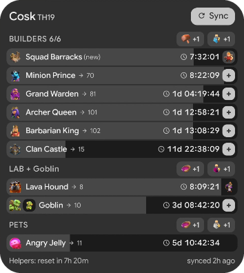
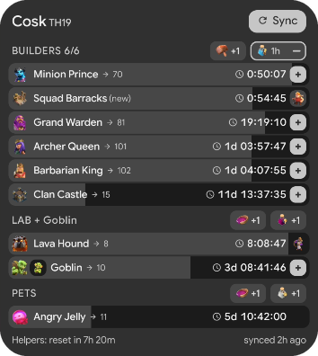
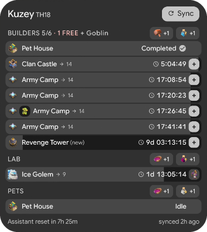
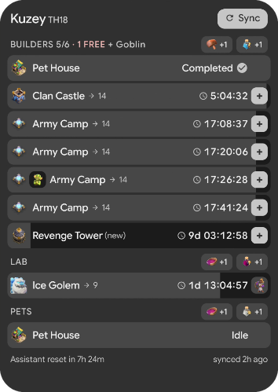
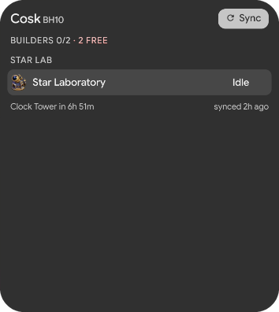

# Clash Timer

[](https://github.com/coskkseyy/clash-timers-m3/releases/tag/latest)

[](LICENSE)

A Material You home screen widget for Android that shows your Clash of Clans builder, laboratory and pet house timers at a glance. Colors follow your wallpaper, and it works fully offline: no account, no server, no ads and no internet permission.

> This is an unofficial fan project and is not endorsed by Supercell. See the [disclaimer](#disclaimer).

## Screenshots

<table>
  <tr>
    <td width="33%"></td>
    <td width="33%"></td>
    <td width="33%"></td>
  </tr>
  <tr>
    <td align="center">Widget</td>
    <td align="center">With a Builder Potion running</td>
    <td align="center">A second account</td>
  </tr>
  <tr>
    <td width="33%" valign="top"></td>
    <td width="33%" valign="top"></td>
    <td></td>
  </tr>
  <tr>
    <td align="center">Full size</td>
    <td align="center">Builder Base</td>
    <td></td>
  </tr>
</table>

## Features

- **Every timer in one widget:** all your builders, the Goblin Builder, the laboratory with the Goblin Researcher, and the pet house, with progress bars and icons.
- **Three widgets:** the full widget, a 2×2 mini one with the next upgrades to finish, and a Builder Base widget (builders, Star Laboratory, Clock Tower).
- **Material You:** colors follow the system palette, in light and dark mode. The widget scales with its size and squeezes its rows to keep the footer visible.
- **Two accounts:** every widget shows one account with its own name. Sync only updates the widget you tapped it on, so you can keep a second village next to yours.
- **Live countdowns:** times tick every second without opening the app, and an optional mode shows finish clock times instead (24-hour).
- **Real finish times:** the in-game timer ignores helpers you haven't used yet. Clash Timer includes the coming Builder's Apprentice and Lab Assistant sessions, so you see when an upgrade will really finish. The footer shows when each helper resets, for example `Helpers: reset in 15h 32m`.
- **Potions and snacks:** a Builder Potion, Research Potion, Pet Potion, Builder Bite or Study Soup that you have running is read from the export and counted in every countdown. Boosts stack like in the game. A Gold Pass boost setting scales the progress bars.
- **Helper links:** tap `+` on a row to put the Apprentice or Lab Assistant on that upgrade.
- **Free builder warning:** the header counts free builders; the Goblin never counts.
- **Notifications:** get told the moment a builder, the lab or the pet house is free. Tapping the notification opens Clash of Clans.
- **English and Türkçe:** the app follows the phone language, or you can pick one in Settings. Turkish mode uses the game's own Turkish item names.
- **Up to date:** names, upgrade times and icons come from the game data, including Town Hall 19.

## Install

Clash Timer isn't on the Play Store, so you install the APK yourself.

1. On your phone, download `ClashTimer.apk` from the [latest build](https://github.com/coskkseyy/clash-timers-m3/releases/tag/latest).
2. Open the file. If Android asks, allow installs from your browser or file manager.

Requires Android 8.0 or newer (Material You colors need Android 12 or newer). Every push to `main` builds a new APK, so updates install over the old one.

## Setup

1. **Open the app once** and allow notifications if you want finish alerts.
2. **Add the widget.** Long-press your home screen, choose **Widgets**, find **Clash Timer** and place it. A short screen asks which account the widget shows (pick one or add a new account) and what name to show.
3. **Sync your village.** In Clash of Clans, go to **Settings → Data Export → Copy**. Go back to your home screen and tap **Sync** on the widget.

To change a widget's account or name later, long-press it and use its settings (reconfigure) option.

### Battery and auto-start

Many phones stop background apps to save battery, which can make notifications arrive late or stop after a reboot. To prevent that, open the app, go to **Settings → App settings (battery, auto-start)**, and then:

- Set battery use to **Unrestricted** (some phones call it **No restrictions**).
- Turn on **Auto-start** if your phone has it. Xiaomi, Oppo, Vivo and others often do.

## How sync works

The game doesn't offer a live connection, so the widget works from the **village data export** you copy in the game.

1. **Copy:** the export is a block of text the game puts on your clipboard. It lists your upgrades and how much time each had left when you copied it.
2. **Sync:** when you tap Sync, the app reads the clipboard once, checks that it's a village export (and that it belongs to the widget's account) and saves the timers. It doesn't read the clipboard at any other time. Android 12 and newer may show a "pasted from clipboard" message, which is normal.
3. **Countdown:** the export records when it was copied, so timers stay correct even if you sync a while later. From then on the app works out the remaining time on the phone.

Sync again whenever you start a new upgrade or change something in the game. The widget can't see the game by itself.

## Privacy

**The app has no internet permission**, so it can't send anything anywhere. You can check this in the [manifest](app/src/main/AndroidManifest.xml).

- There's no account, analytics, ads or tracking.
- It only reads the clipboard when you tap Sync.
- Your village data and settings are stored in the app's private storage on your phone.
- Crash reports stay on your phone too. You choose whether to copy one and share it.

If you've turned on Android's own system backup, Android may include this app's data in your personal Google backup, as it does for most apps. That is done by Android, not by this app.

| Permission | Why it's needed |
|---|---|
| Exact alarms (`USE_EXACT_ALARM`, `SCHEDULE_EXACT_ALARM`) | Update the widget at the exact moment a timer finishes |
| Notifications (`POST_NOTIFICATIONS`) | Tell you when a builder, the lab or the pet house is free |
| Run at startup (`RECEIVE_BOOT_COMPLETED`) | Set the alarms again after a reboot |

## FAQ

**Why does the widget show a shorter time than the game?**
The game's timer doesn't count helper sessions that haven't happened yet. The widget does, so it shows the predicted finish. The next helper session is exact. Later ones are a best case, because a session only starts once you're in the game. Each sync corrects the prediction.

**Sync failed. What should I do?**
Copy the data again in the game (**Settings → Data Export → Copy**) and tap Sync straight away. Sync fails if the clipboard holds something else, or if the export is older than the one already saved.

**The widget's countdowns don't tick on my launcher.**
Some launchers don't draw live countdowns properly. Turn off **Live seconds countdown** in the app and the widget shows times like `1d 20h` instead.

**Notifications arrive late or not at all.**
Follow the [battery and auto-start](#battery-and-auto-start) steps, and check that notifications are on in the app's Settings.

**A row says `Unknown (1000123)`.**
That's something new from a game update which the app doesn't have a name for yet. Please [open an issue](https://github.com/coskkseyy/clash-timers-m3/issues/new/choose) with the number.

**Does it support the Builder Base?**
Yes, with its own widget (builders, Star Laboratory and the Clock Tower). It needs a Sync with the Builder Base data in the export, like the home village.

**Can this get my account banned?**
The app doesn't connect to the game or change it, and it doesn't automate anything. It only reads the text that the game's own export button copies. It's still an unofficial app, and Supercell's rules are theirs to decide.

**The app crashed. How do I report it?**
Open the app, find **Last crash**, tap **Copy** and paste the report into a [bug report](https://github.com/coskkseyy/clash-timers-m3/issues/new/choose).

## Building from source

You'll need:

- [Android Studio](https://developer.android.com/studio), or the Android SDK with platform 37 installed.
- JDK 25. Android Studio's bundled JDK works, and Gradle downloads one if it can't find it.

Android Studio finds the SDK by itself. If you only use the command line, set `ANDROID_HOME` to your SDK folder first.

```sh
git clone https://github.com/coskkseyy/clash-timers-m3.git
cd clash-timers-m3
./gradlew :app:testDebugUnitTest   # run the unit tests
./gradlew assembleDebug            # debug build you can install right away
```

### Release build

```sh
./gradlew assembleRelease
```

Android only installs signed APKs. Without a keystore this produces `app-release-unsigned.apk`, so create your own:

```sh
keytool -genkeypair -v -keystore my-release.jks -alias mykey -keyalg RSA -keysize 4096 -validity 18250
```

Then put its details in `~/.android-signing/clashtimers/keystore.properties`:

```properties
storeFile=/absolute/path/to/my-release.jks
storePassword=your-store-password
keyAlias=mykey
keyPassword=your-key-password
```

To keep this file somewhere else, pass `-PclashtimersSigning=/path/to/keystore.properties`. Never commit your keystore or this file.

The signed APK is written to `app/build/outputs/apk/release/`. Android won't install it over the official release because the signatures differ, so uninstall that version first. The official builds are signed in GitHub Actions with a key kept in repository secrets, never in the repo.

### Project layout

| Path | Contents |
|---|---|
| `app/src/main/java/.../core` | Export parser, timer engine and widget model (plain Kotlin, unit tested) |
| `app/src/main/java/.../widget` | The RemoteViews widget |
| `app/src/main/java/.../sync` | Reading the clipboard and saving the result |
| `app/src/test/resources/fixtures` | Anonymized village exports used by the tests |
| `tools/` | Scripts that regenerate names, upgrade times, Turkish names and icons from [clash-of-clans-data](https://github.com/chiefpansancolt/clash-of-clans-data) or from the game's own logic files (see `gen_game_data.py`, `gen_names_tr.py`) |

See [CONTRIBUTING.md](CONTRIBUTING.md) if you'd like to help.

## License

The code is under the [MIT License](LICENSE). That doesn't cover the game art and data, or the font. See [NOTICE](NOTICE) for details.

This project is a fork of [Clash Timers](https://github.com/Kuswaa/clash-timers) by Kuswa Tul Kaabah (MIT), reworked into a Material You app. The original copyright notice stays in [LICENSE](LICENSE).

## Disclaimer

This material is unofficial and is not endorsed by Supercell. For more information see Supercell's Fan Content Policy: [www.supercell.com/fan-content-policy](https://www.supercell.com/fan-content-policy).

Clash of Clans names and images are the property of Supercell.
